  

## Hi, I'm Aeternus

Backend developer (C#) at ChiTech, based in Novi Sad, Serbia.

- Bachelor's degree with honours in Applied Informatics, RANEPA (Moscow)
- Master's student at RANEPA (Applied Informatics, game design)
- Interests: gongfu tea, hiking and trekking, learning Serbian

## Stack

     

## Current

| Project | What it is |
|---|---|
| [Sip & Tell](https://github.com/Dgrabovets/SipAndTell) | Tea diary for friends, a Telegram Mini App. An experiment: I am the client, Claude writes the code |
| [S.T.E.W.A.R.D](https://github.com/Dgrabovets/S.T.E.W.A.R.D) | Personal utilities that create tasks in SingularityApp, and a Windows tray app that runs them |
| [S.T.E.W.A.R.D.Purser](https://github.com/Dgrabovets/S.T.E.W.A.R.D.Purser) | Python core for trading USDT perpetuals on Bybit. The system gives a signal and a position size, I make the call |
| [Ekpiroza](https://github.com/Dgrabovets/Ekpiroza) | Unity game prototype, my master's individual project |
| [InventoryApp](https://github.com/Dgrabovets/InventoryApp) | Home inventory tool in C# |

## Finished

| Project | What it is |
|---|---|
| [BottleGameAPI](https://github.com/Dgrabovets/BottleGameAPI) | ASP.NET Core and PostgreSQL backend for a Telegram mini-app game, with a demo mode |
| [BottleGameAdministrationPanel](https://github.com/Dgrabovets/BottleGameAdministrationPanel) | Admin dashboard for BottleGameAPI, in TypeScript |

## Stats

  
  

