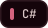
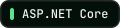
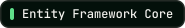
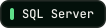
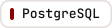
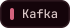
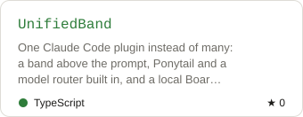
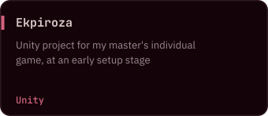
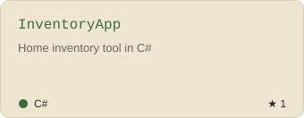
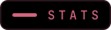

<picture><source media="(prefers-color-scheme: dark)" srcset="assets/banner-dark.svg"></picture>

## <picture><source media="(prefers-color-scheme: dark)" srcset="assets/headings/about-dark.svg"></picture>

**At work, ChiTech**

- Delivery integrations, including Yandex: shipment registration, status exchange, shipping documents
- Marketplace integrations: Kuper, Ozon, Wildberries, T-Shop
- Order picking and handover for marketplace orders in the company's stores
- A VAT rate change across 10+ systems, delivered on time with my team

I'm based in Novi Sad and open to relocation. I studied applied informatics at RANEPA (honours). Master's student in game design at RANEPA. 

Away from code: travelling (30+ countries so far), hiking and trekking, weightlifting.

## <picture><source media="(prefers-color-scheme: dark)" srcset="assets/headings/stack-dark.svg"></picture>

<picture><source media="(prefers-color-scheme: dark)" srcset="assets/badges/csharp-dark.svg"></picture>
<picture><source media="(prefers-color-scheme: dark)" srcset="assets/badges/dotnet-dark.svg"></picture>
<picture><source media="(prefers-color-scheme: dark)" srcset="assets/badges/aspnet-core-dark.svg"></picture>
<picture><source media="(prefers-color-scheme: dark)" srcset="assets/badges/ef-core-dark.svg"></picture>
<picture><source media="(prefers-color-scheme: dark)" srcset="assets/badges/sql-server-dark.svg"></picture>
<picture><source media="(prefers-color-scheme: dark)" srcset="assets/badges/postgresql-dark.svg"></picture>
<picture><source media="(prefers-color-scheme: dark)" srcset="assets/badges/kafka-dark.svg"></picture>
<picture><source media="(prefers-color-scheme: dark)" srcset="assets/badges/rabbitmq-dark.svg"></picture>
<picture><source media="(prefers-color-scheme: dark)" srcset="assets/badges/docker-dark.svg"></picture>
<picture><source media="(prefers-color-scheme: dark)" srcset="assets/badges/ci-cd-dark.svg"></picture>
<picture><source media="(prefers-color-scheme: dark)" srcset="assets/badges/automated-tests-dark.svg"></picture>
<picture><source media="(prefers-color-scheme: dark)" srcset="assets/badges/typescript-dark.svg"></picture>
<picture><source media="(prefers-color-scheme: dark)" srcset="assets/badges/python-dark.svg"></picture>

## <picture><source media="(prefers-color-scheme: dark)" srcset="assets/headings/current-dark.svg"></picture>

<a href="https://github.com/Dgrabovets/UnifiedBand"><picture><source media="(prefers-color-scheme: dark)" srcset="assets/cards/UnifiedBand-dark.svg"></picture></a>
<a href="https://github.com/Dgrabovets/SipAndTell"><picture><source media="(prefers-color-scheme: dark)" srcset="assets/cards/SipAndTell-dark.svg"></picture></a>
<a href="https://github.com/Dgrabovets/S.T.E.W.A.R.D"><picture><source media="(prefers-color-scheme: dark)" srcset="assets/cards/S.T.E.W.A.R.D-dark.svg"></picture></a>
<a href="https://github.com/Dgrabovets/S.T.E.W.A.R.D.Purser"><picture><source media="(prefers-color-scheme: dark)" srcset="assets/cards/S.T.E.W.A.R.D.Purser-dark.svg"></picture></a>
<a href="https://github.com/Dgrabovets/Ekpiroza"><picture><source media="(prefers-color-scheme: dark)" srcset="assets/cards/Ekpiroza-dark.svg"></picture></a>
<a href="https://github.com/Dgrabovets/InventoryApp"><picture><source media="(prefers-color-scheme: dark)" srcset="assets/cards/InventoryApp-dark.svg"></picture></a>

## <picture><source media="(prefers-color-scheme: dark)" srcset="assets/headings/finished-dark.svg"></picture>

<a href="https://github.com/Dgrabovets/BottleGameAPI"><picture><source media="(prefers-color-scheme: dark)" srcset="assets/cards/BottleGameAPI-dark.svg"></picture></a>
<a href="https://github.com/Dgrabovets/BottleGameAdministrationPanel"><picture><source media="(prefers-color-scheme: dark)" srcset="assets/cards/BottleGameAdministrationPanel-dark.svg"></picture></a>

## <picture><source media="(prefers-color-scheme: dark)" srcset="assets/headings/stats-dark.svg"></picture>

<picture><source media="(prefers-color-scheme: dark)" srcset="assets/stats-dark.svg"></picture>

Cards and stats are generated daily by a workflow in this repository.
