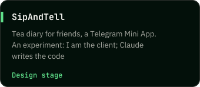
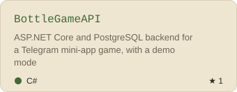
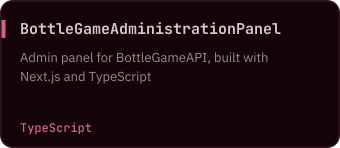
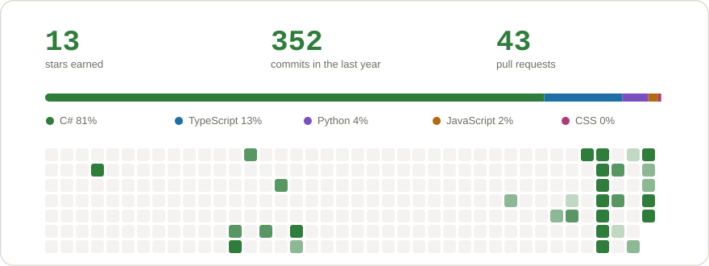

<picture><source media="(prefers-color-scheme: dark)" srcset="assets/banner-dark.svg"></picture>

## Hi, I'm Aeternus

Backend developer (C#) at ChiTech, based in Novi Sad, Serbia.

- Bachelor's degree with honours in Applied Informatics, RANEPA (Moscow)
- Master's student at RANEPA (Applied Informatics, game design)
- Interests: gongfu tea, hiking and trekking, learning Serbian

## Stack

     

## Current

<table>
<tr><td width="50%"><a href="https://github.com/Dgrabovets/UnifiedBand"><picture><source media="(prefers-color-scheme: dark)" srcset="assets/cards/UnifiedBand-dark.svg"></picture></a></td><td width="50%"><a href="https://github.com/Dgrabovets/SipAndTell"><picture><source media="(prefers-color-scheme: dark)" srcset="assets/cards/SipAndTell-dark.svg"></picture></a></td></tr>
<tr><td width="50%"><a href="https://github.com/Dgrabovets/S.T.E.W.A.R.D"><picture><source media="(prefers-color-scheme: dark)" srcset="assets/cards/S.T.E.W.A.R.D-dark.svg"></picture></a></td><td width="50%"><a href="https://github.com/Dgrabovets/S.T.E.W.A.R.D.Purser"><picture><source media="(prefers-color-scheme: dark)" srcset="assets/cards/S.T.E.W.A.R.D.Purser-dark.svg"></picture></a></td></tr>
<tr><td width="50%"><a href="https://github.com/Dgrabovets/Ekpiroza"><picture><source media="(prefers-color-scheme: dark)" srcset="assets/cards/Ekpiroza-dark.svg"></picture></a></td><td width="50%"><a href="https://github.com/Dgrabovets/InventoryApp"><picture><source media="(prefers-color-scheme: dark)" srcset="assets/cards/InventoryApp-dark.svg"></picture></a></td></tr>
</table>

## Finished

<table>
<tr><td width="50%"><a href="https://github.com/Dgrabovets/BottleGameAPI"><picture><source media="(prefers-color-scheme: dark)" srcset="assets/cards/BottleGameAPI-dark.svg"></picture></a></td><td width="50%"><a href="https://github.com/Dgrabovets/BottleGameAdministrationPanel"><picture><source media="(prefers-color-scheme: dark)" srcset="assets/cards/BottleGameAdministrationPanel-dark.svg"></picture></a></td></tr>
</table>

## Stats

<picture><source media="(prefers-color-scheme: dark)" srcset="assets/stats-dark.svg"></picture>

Cards and stats are generated daily by a workflow in this repository.
